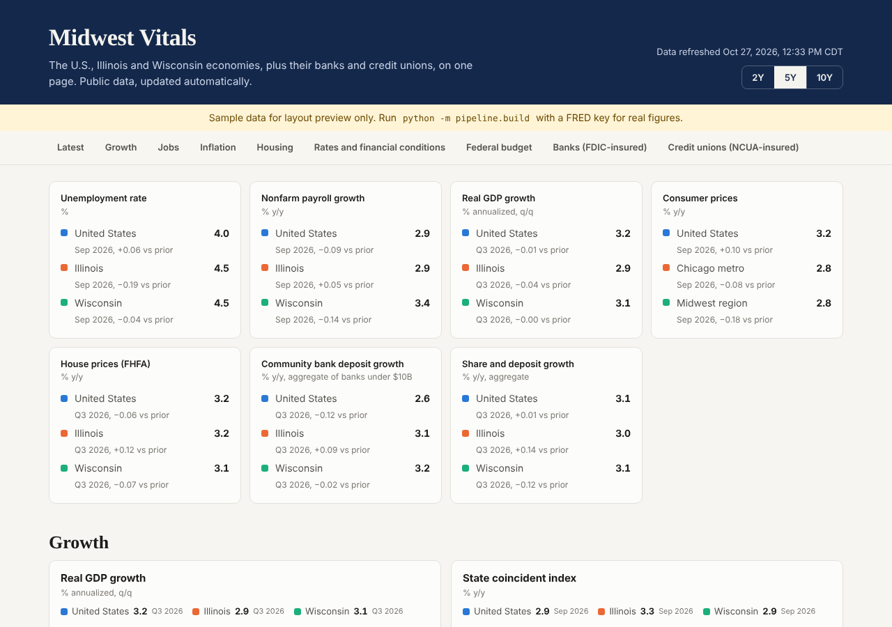

# Midwest Vitals

One page of charts on the U.S., Illinois and Wisconsin economies, plus the banks and credit unions headquartered in each, refreshed automatically from public data. Modeled on the format of [Econvitals](https://econvitals.org).



## What's on the page

| Section | U.S. | Illinois / Wisconsin |
|---|---|---|
| Growth | Real GDP, personal income, coincident index, CFNAI | Quarterly real GDP, personal income, Philly Fed coincident index |
| Jobs | Unemployment, payrolls, participation, claims, wages, openings | Same, except openings (state JOLTS is on the backlog) |
| Inflation | CPI, core CPI, core PCE, breakevens | Chicago metro CPI (IL proxy), Midwest regional CPI (WI proxy) |
| Housing | FHFA prices, permits, mortgage rate | FHFA prices, permits |
| Rates and financial conditions | Fed funds, Treasuries, curve, NFCI, HY spread | National only |
| Federal budget | Deficit, debt | State fiscal data is on the backlog |
| Banks | FDIC call reports | Count, community bank deposit and loan growth, LTD, liquidity, FHLB advances, brokered deposits, NIM, ROA, noncurrent loans, capital |
| Credit unions | NCUA call reports | Count, share and loan growth, loan-to-share, net worth, ROA, delinquency |

Every chart is defined in [`config/series.yaml`](config/series.yaml). Nothing is hardcoded in the front end.

## How it works

```
config/series.yaml  ->  pipeline/build.py  ->  site/data/dashboard.json  ->  site/ (static HTML + Chart.js)
                        (FRED, FDIC, NCUA)      (+ optional AI summaries)
```

A GitHub Action runs the pipeline twice each weekday, commits the refreshed JSON, and redeploys to GitHub Pages. If any one chart fails to refresh, the last good version stays up with a "Not refreshed" tag.

## Quick start

```bash
python -m venv .venv && source .venv/bin/activate
pip install -r requirements.txt
cp .env.example .env            # add your FRED key

python -m pytest -q             # offline tests
python -m pipeline.build --sample   # preview layout with fake data, no keys needed
python -m http.server -d site 8000  # open http://localhost:8000

python -m pipeline.validate     # check every series ID and FDIC field
python -m pipeline.build        # real data (first NCUA run downloads ~10 years of files)
python -m pipeline.ai_notes     # optional, needs ANTHROPIC_API_KEY
```

## Deploy

1. Push to a new GitHub repository.
2. Settings > Secrets and variables > Actions: add `FRED_API_KEY` (and optionally `ANTHROPIC_API_KEY`).
3. Settings > Pages: set Source to "GitHub Actions".
4. Actions > "Update data and deploy" > Run workflow.

## Adding a chart

Add an entry under the right section in `config/series.yaml`, run `python -m pipeline.validate`, then `python -m pipeline.build`. Transforms (`yoy`, `ann_rate`, `diff`, `ma3`, `index_2019`, `roll12_sum`, `scale:X`) are documented at the top of the config.

## Data caveats

- No state CPI exists; the Chicago and Midwest indexes are proxies.
- State GDP and personal income lag national figures by about a quarter.
- Bank and credit union data are by headquarters state. Illinois includes a few very large Chicago-chartered banks, so the bank section uses medians and a sub-$10 billion community bank cohort rather than all-bank totals.
- AI summaries are generated from the page's own numbers and are not reviewed before publishing.

## Sources

[FRED](https://fred.stlouisfed.org) · [FDIC BankFind API](https://banks.data.fdic.gov/docs/) · [NCUA call report data](https://ncua.gov/analysis/credit-union-corporate-call-report-data/quarterly-data)
